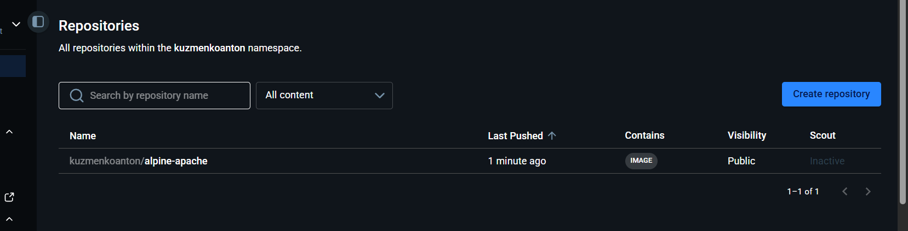

docker build -t kuzmenkoanton/alpine-apache:1.0 .

[+] Building 8.9s (8/8) FINISHED                                                                                                                              docker:desktop-linux
=> [internal] load build definition from Dockerfile                                                                                                                          0.0s
=> => transferring dockerfile: 280B                                                                                                                                          0.0s
=> [internal] load metadata for docker.io/library/alpine:3.24                                                                                                                2.9s
=> [internal] load .dockerignore                                                                                                                                             0.0s
=> => transferring context: 349B                                                                                                                                             0.0s
=> [1/3] FROM docker.io/library/alpine:3.24@sha256:294b683cb724975bec92580e1e685676bd4b50bda910ddb8c51d4cabeaec77e6                                                          3.1s
=> => resolve docker.io/library/alpine:3.24@sha256:294b683cb724975bec92580e1e685676bd4b50bda910ddb8c51d4cabeaec77e6                                                          0.0s
=> => sha256:e2de96513ba9eb53b431787ec8a65cdde380ac4772a3e4c4b714dcfde2a102b5 3.85MB / 3.85MB                                                                                2.8s
=> => extracting sha256:e2de96513ba9eb53b431787ec8a65cdde380ac4772a3e4c4b714dcfde2a102b5                                                                                     0.2s
=> [internal] load build context                                                                                                                                             0.0s
=> => transferring context: 547B                                                                                                                                             0.0s
=> [2/3] RUN apk add --no-cache apache2                                                                                                                                      2.4s
=> [3/3] COPY index.html /var/www/localhost/htdocs/index.html                                                                                                                0.0s
=> exporting to image                                                                                                                                                        0.3s
=> => exporting layers                                                                                                                                                       0.2s
=> => exporting manifest sha256:e0b1e76b6acd58912fbdf4c7a101779cc10dea6d0d02c615069535a898edc976                                                                             0.0s
=> => exporting config sha256:aa66f79747f3307c2b75e98a870acfc49a7cdbc28c1d73d6b2ca8c1cbd9e1308                                                                               0.0s
=> => exporting attestation manifest sha256:522109316ae6c998381f5d21f72ed75d851065057910e1d3a0cdc29563b1d18e                                                                 0.0s
=> => exporting manifest list sha256:6d2253d3973ed4818cb415234519c0c576adf06bae2c63bdb8c41faab58f9e08                                                                        0.0s
=> => naming to docker.io/kuzmenkoanton/alpine-apache:1.0                                                                                                                    0.0s
=> => unpacking to docker.io/kuzmenkoanton/alpine-apache:1.0                                                                                                                 0.1s

docker images
docker images
REPOSITORY                    TAG        IMAGE ID       CREATED          SIZE
kuzmenkoanton/alpine-apache   1.0        6d2253d3973e   58 seconds ago   18.7MB
redis                         7-alpine   520775a41a63   3 weeks ago      57.3MB
grammy-tg-bot-bot             latest     32f257074342   13 months ago    276MB
mongo                         6          363f5fab76d1   14 months ago    1.05GB

docker run -d -p 8080:80 --name Anton-web kuzmenkoanton/alpine-apache:1.0

1ebd9b1e8e390a6e997e49bd39138d1fd552ba9e3d45f1fbb490f634fb0f9146

docker ps

docker ps
CONTAINER ID   IMAGE                             COMMAND                 CREATED          STATUS          PORTS                  NAMES
1ebd9b1e8e39   kuzmenkoanton/alpine-apache:1.0   "httpd -D FOREGROUND"   21 seconds ago   Up 20 seconds   0.0.0.0:8080->80/tcp   nton-web

curl -i http://localhost:8080

HTTP/1.1 200 OK
Date: Fri, 09 Oct 2026 13:09:32 GMT
Server: Apache/2.4.69 (Unix)
Last-Modified: Fri, 09 Oct 2026 12:56:54 GMT
ETag: "1fc-65d67e1f1d180"
Accept-Ranges: bytes
Content-Length: 508
Content-Type: text/html

<!DOCTYPE html>
<html lang="uk">
<head>
    <meta charset="UTF-8">
    <meta name="viewport" content="width=device-width, initial-scale=1">
    <title>Лабораторна робота 3: Dockerfile</title>
</head>
<body>
<h1>Apache HTTP Server в Docker</h1>

<strong>Курс:</strong> 3

<strong>Група:</strong> 1254-пі-2

<strong>Студент:</strong> Кузьменко Антон

<strong>Базовий образ:</strong> alpine:3.24

</body>
</html>

docker history kuzmenkoanton/alpine-apache:1.0

IMAGE          CREATED         CREATED BY                                      SIZE      COMMENT
6d2253d3973e   5 minutes ago   CMD ["httpd" "-D" "FOREGROUND"]                 0B        buildkit.dockerfile.v0
<missing>      5 minutes ago   EXPOSE map[80/tcp:{}]                           0B        buildkit.dockerfile.v0
<missing>      5 minutes ago   COPY index.html /var/www/localhost/htdocs/in…   24.6kB    buildkit.dockerfile.v0
<missing>      5 minutes ago   RUN /bin/sh -c apk add --no-cache apache2 # …   4.34MB    buildkit.dockerfile.v0
<missing>      5 minutes ago   LABEL author=Anton Kuzmenko group=1254-пі-2 …   0B        buildkit.dockerfile.v0
<missing>      3 weeks ago     CMD ["/bin/sh"]                                 0B        buildkit.dockerfile.v0
<missing>      3 weeks ago     ADD alpine-minirootfs-3.24.2-x86_64.tar.gz /…   9.08MB    buildkit.dockerfile.v0

docker login

Waiting for authentication in the browser…
Login Succeeded

docker push kuzmenkoanton/alpine-apache:1.0

The push refers to repository [docker.io/kuzmenkoanton/alpine-apache]
e3ec1e6ca392: Pushed
1f68e4723b9c: Pushed
e2de96513ba9: Pushed
2dca47dc8339: Pushed
1.0: digest: sha256:6d2253d3973ed4818cb415234519c0c576adf06bae2c63bdb8c41faab58f9e08 size: 855

PS D:\znu\devops\lab3> docker stop nton-web
nton-web
PS D:\znu\devops\lab3> docker rm nton-web
nton-web
PS D:\znu\devops\lab3> docker rmi kuzmenkoanton/alpine-apache:1.0
Untagged: kuzmenkoanton/alpine-apache:1.0
Deleted: sha256:6d2253d3973ed4818cb415234519c0c576adf06bae2c63bdb8c41faab58f9e08

docker pull kuzmenkoanton/alpine-apache:1.0
1.0: Pulling from kuzmenkoanton/alpine-apache
1f68e4723b9c: Pull complete
2dca47dc8339: Pull complete
Digest: sha256:6d2253d3973ed4818cb415234519c0c576adf06bae2c63bdb8c41faab58f9e08
Status: Downloaded newer image for kuzmenkoanton/alpine-apache:1.0
docker.io/kuzmenkoanton/alpine-apache:1.0

docker build -t kuzmenkoanton/alpine-apache:1.1 page/

[+] Building 1.8s (8/8) FINISHED                                                                                                                              docker:desktop-linux
=> [internal] load build definition from Dockerfile                                                                                                                          0.0s
=> => transferring dockerfile: 179B                                                                                                                                          0.0s
=> [internal] load metadata for docker.io/kuzmenkoanton/alpine-apache:1.0                                                                                                    0.1s
=> [internal] load .dockerignore                                                                                                                                             0.0s
=> => transferring context: 2B                                                                                                                                               0.0s
=> [internal] load build context                                                                                                                                             0.0s
=> => transferring context: 597B                                                                                                                                             0.0s
=> [1/2] FROM docker.io/kuzmenkoanton/alpine-apache:1.0@sha256:6d2253d3973ed4818cb415234519c0c576adf06bae2c63bdb8c41faab58f9e08                                              1.5s
=> => resolve docker.io/kuzmenkoanton/alpine-apache:1.0@sha256:6d2253d3973ed4818cb415234519c0c576adf06bae2c63bdb8c41faab58f9e08                                              1.5s
=> [auth] kuzmenkoanton/alpine-apache:pull token for registry-1.docker.io                                                                                                    0.0s
=> [2/2] COPY index.html /var/www/localhost/htdocs/index.html                                                                                                                0.0s
=> exporting to image                                                                                                                                                        0.1s
=> => exporting layers                                                                                                                                                       0.1s
=> => exporting manifest sha256:4ff842536c70d26fb1e68c4d9846602ae34e7732d9fd1121f567419715e67def                                                                             0.0s
=> => exporting config sha256:edfd6efbbec8548280782a1e881891aae2525030050fa39f6bc914af6f48b52e                                                                               0.0s
=> => exporting attestation manifest sha256:6f0c0161ce2facc1f63309b2f721f8188f6d0e1575e3fee4fead1e6d5480dc4a                                                                 0.0s
=> => exporting manifest list sha256:317aaa4914a18b3065ab46429a922e7c0c4e43c5e871c63de0dbf9baa64e618f                                                                        0.0s
=> => naming to docker.io/kuzmenkoanton/alpine-apache:1.1                                                                                                                    0.0s
=> => unpacking to docker.io/kuzmenkoanton/alpine-apache:1.1                                                                                                                 0.0s

docker run -d -p 8080:80 --name kuzmenkoanton-page kuzmenkoanton/alpine-apache:1.1

6c28b45846f6fc4f09adc0bc3051ad9d5e7e796d7feeb04ebcd11846ddbca14b

curl.exe -i http://localhost:8080

HTTP/1.1 200 OK
Date: Fri, 09 Oct 2026 13:30:24 GMT
Server: Apache/2.4.69 (Unix)
Last-Modified: Fri, 09 Oct 2026 13:26:02 GMT
ETag: "22e-65d684a222e80"
Accept-Ranges: bytes
Content-Length: 558
Content-Type: text/html

<!DOCTYPE html>
<html lang="uk">
<head>
    <meta charset="UTF-8">
    <meta name="viewport" content="width=device-width, initial-scale=1">
    <title>Лабораторна робота 3: Docker</title>
</head>
<body>
<h1>Apache HTTP Server в Docker (образ 1.1)</h1>

<strong>Дисципліна:</strong> DevOps

<strong>Група:</strong> 1254-пі-2

<strong>Студент:</strong> Кузьменко Антон

<strong>Базовий образ:</strong> kuzmenkoanton/alpine-apache:1.0

</body>
</html>

aws ecr describe-images --region $AWS_REGION --repository-name $LAB_ECR_REPOSITORY --image-ids imageTag=1.1 --query 'imageDetails[0].{Tag:imageTags,Digest:imageDigest}'
{
"Tag": [
"1.1"
],
"Digest": "sha256:317aaa4914a18b3065ab46429a922e7c0c4e43c5e871c63de0dbf9baa64e618f"
}

PS C:\Users\Антон> curl.exe -i http://localhost:8081

HTTP/1.1 200 OK
Date: Fri, 09 Oct 2026 14:02:45 GMT
Server: Apache/2.4.69 (Unix)
Last-Modified: Fri, 09 Oct 2026 13:26:02 GMT
ETag: "22e-65d684a222e80"
Accept-Ranges: bytes
Content-Length: 558
Content-Type: text/html

<!DOCTYPE html>
<html lang="uk">
<head>
    <meta charset="UTF-8">
    <meta name="viewport" content="width=device-width, initial-scale=1">
    <title>Лабораторна робота 3: Docker</title>
</head>
<body>
<h1>Apache HTTP Server в Docker (образ 1.1)</h1>

<strong>Дисципліна:</strong> DevOps

<strong>Група:</strong> 1254-пі-2

<strong>Студент:</strong> Кузьменко Антон

<strong>Базовий образ:</strong> kuzmenkoanton/alpine-apache:1.0

</body>
</html>

docker pull $LAB_ECR_IMAGE

1.1: Pulling from lab3-kuzmenkoanton-alpine-apache
Digest: sha256:317aaa4914a18b3065ab46429a922e7c0c4e43c5e871c63de0dbf9baa64e618f
Status: Downloaded newer image for 789941186281.dkr.ecr.us-east-1.amazonaws.com/lab3-kuzmenkoanton-alpine-apache:1.1
789941186281.dkr.ecr.us-east-1.amazonaws.com/lab3-kuzmenkoanton-alpine-apache:1.1

docker stop kuzmenkoanton-page kuzmenkoanton-ecr
kuzmenkoanton-page
kuzmenkoanton-ecr
PS C:\Users\Антон> docker rm kuzmenkoanton-page kuzmenkoanton-ecr
kuzmenkoanton-page
kuzmenkoanton-ecr
PS C:\Users\Антон> docker ps -a
CONTAINER ID   IMAGE               COMMAND                  CREATED         STATUS                     PORTS     NAMES
f2dff260312f   redis:7-alpine      "docker-entrypoint.s…"   2 weeks ago     Exited (0) 10 days ago               science_tech_redis
9c25e77449b4   grammy-tg-bot-bot   "docker-entrypoint.s…"   13 months ago   Exited (0) 13 months ago             telegram_bot_store
5e18eee17dca   mongo:6             "docker-entrypoint.s…"   13 months ago   Exited (0) 13 months ago             mongo-db
PS C:\Users\Антон> docker rmi $LAB_ECR_IMAGE
Untagged: 789941186281.dkr.ecr.us-east-1.amazonaws.com/lab3-kuzmenkoanton-alpine-apache:1.1
PS C:\Users\Антон> docker rmi kuzmenkoanton/alpine-apache:1.1 kuzmenkoanton/alpine-apache:1.0
Untagged: kuzmenkoanton/alpine-apache:1.1
Deleted: sha256:317aaa4914a18b3065ab46429a922e7c0c4e43c5e871c63de0dbf9baa64e618f
Untagged: kuzmenkoanton/alpine-apache:1.0
Deleted: sha256:6d2253d3973ed4818cb415234519c0c576adf06bae2c63bdb8c41faab58f9e08

